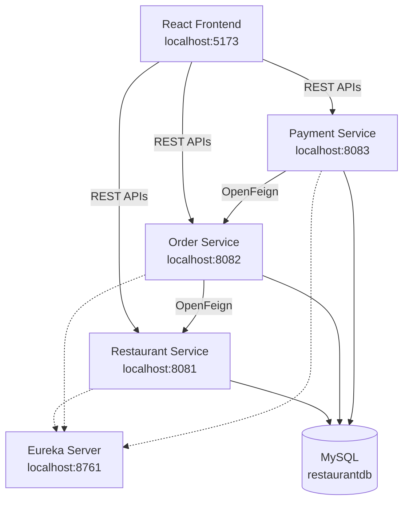

# FeastHub – Restaurant Management System

FeastHub is a restaurant ordering and management application developed using React and Spring Boot Microservices. It allows customers to browse restaurants, view food menus, place orders, and track order status. Administrators can manage restaurants, food items, customer orders, and Cash on Delivery (COD) payments.

## Features

### Customer
- Register and log in using the application's authentication system.
- Browse restaurants and available food items.
- Add food items to the cart and place orders.
- Choose Cash on Delivery (COD).
- View order history and order status.

### Admin
- Manage restaurants and food items.
- View customer orders.
- Update order fulfilment status.
- View COD payment status and mark cash as collected.

## Backend Architecture

- Separate microservices for restaurant, order, and payment management.
- Eureka Service Discovery for service registration and discovery.
- OpenFeign for inter-service communication.
- JWT-based authentication in the Restaurant Service.
- MySQL for data persistence.

## Architecture Diagram



The React frontend communicates with backend services through REST APIs. The Order Service communicates with the Restaurant Service using OpenFeign. The Payment Service retrieves order details from the Order Service through OpenFeign.

## Technology Stack

| Area | Technology |
|---|---|
| Frontend | React, JavaScript, Vite |
| Backend | Java, Spring Boot |
| Microservices | Spring Cloud, Eureka, OpenFeign |
| Security | Spring Security, JWT |
| Persistence | Spring Data JPA, Hibernate |
| Database | MySQL |
| API Documentation | Springdoc OpenAPI / Swagger UI |
| Build Tool | Maven |

## Repository Structure

```text
Restaurant-Management-System/
│
├── UI-restaurant_frontend/   # React frontend
├── restaurantservice/        # Restaurant and food management
├── orderservice/             # Order management
├── paymentservice/            # COD payment tracking
├── eurekaserver/             # Eureka Service Registry
│
├── .gitignore
└── README.md
```

Each Spring Boot service is an independent Maven project with its own `pom.xml`.

## Prerequisites

- JDK 25
- MySQL Server 8.x
- Node.js and npm
- Maven
- Git

## Local Setup

### 1. Clone the Repository

```bash
git clone https://github.com/chandrasekharbandaru03/Restaurant-Management-System.git
cd Restaurant-Management-System
```

### 2. Create the MySQL Database

Start MySQL and execute:

```sql
CREATE DATABASE restaurantdb;
```

### 3. Configure Database Credentials

For each backend service that requires private credentials, create an `application-local.properties` file inside its `src/main/resources/` directory.

Configure the required credentials:

```properties
spring.datasource.username=YOUR_MYSQL_USERNAME
spring.datasource.password=YOUR_MYSQL_PASSWORD
```

For the Restaurant Service, configure the JWT signing secret as well:

```properties
app.jwt.secret=YOUR_JWT_SECRET
```

Import the local configuration in the corresponding `application.properties`:

```properties
spring.config.import=optional:classpath:application-local.properties
```

Keep passwords and JWT secrets out of the Git repository. The root `.gitignore` excludes `application-local.properties` files.

Only configure properties required by each service. Keep non-secret settings such as service names, ports, database URLs, and Eureka URLs in `application.properties`.

### 4. Run the Backend Services

Start MySQL first. Open separate terminals for each Spring Boot service.

From the respective service directory, run:

```bash
.\mvnw.cmd spring-boot:run
```

Alternatively, when Maven is installed:

```bash
mvn spring-boot:run
```

Start the services in this order:

| Order | Project Folder | Service | Port |
|---|---|---|---|
| 1 | eurekaserver | Eureka Server | 8761 |
| 2 | restaurantservice | Restaurant Service | 8081 |
| 3 | orderservice | Order Service | 8082 |
| 4 | paymentservice | Payment Service | 8083 |

### 5. Run the React Frontend

Open a terminal inside the `UI-restaurant_frontend` directory:

```bash
npm install
npm run dev
```

Access the application:

- Frontend: http://localhost:5173
- Eureka Dashboard: http://localhost:8761

Ensure the backend CORS configuration allows the frontend origin `http://localhost:5173`. Check that the backend services are registered in Eureka before testing operations that depend on service discovery.

## Main API Endpoints

### Restaurant Service – Port 8081

| Method | Endpoint | Description |
|---|---|---|
| GET | `/api/v1/getAllRest` | Retrieve all restaurants |
| GET | `/api/v1/{id}` | Retrieve restaurant by ID |
| GET | `/api/v1/{id}/foods` | Retrieve food items for a restaurant |
| POST | `/api/v1/addRes` | Add a restaurant |
| POST | `/api/v1/restaurants/{restaurantId}/foods` | Add a food item |
| GET | `/api/v1/foods/{foodId}` | Retrieve a food item |
| PUT | `/api/v1/foods/{foodId}` | Update a food item |
| DELETE | `/api/v1/foods/{foodId}` | Delete a food item |

Authentication endpoints are defined in the Restaurant Service's `AuthController`.

### Order Service – Port 8082

| Method | Endpoint | Description |
|---|---|---|
| POST | `/api/v1/orders` | Create an order |
| GET | `/api/v1/orders` | Retrieve all orders |
| GET | `/api/v1/orders/{id}` | Retrieve order by ID |
| GET | `/api/v1/orders/customer/{customerId}` | Retrieve customer orders |
| PUT | `/api/v1/orders/{id}/status?status=CONFIRMED` | Update order status |

### Payment Service – Port 8083

| Method | Endpoint | Description |
|---|---|---|
| POST | `/api/v1/payments` | Create a COD payment record |
| GET | `/api/v1/payments/order/{orderId}` | Retrieve payment details |
| PUT | `/api/v1/payments/{paymentId}/collect` | Mark COD payment as collected |

Refer to the respective controller classes or Swagger UI for complete request and response details.

## COD Payment Flow

1. The customer places an order through the React frontend.
2. The frontend sends the order request to the Order Service.
3. The frontend requests a COD payment record from the Payment Service.
4. The Payment Service retrieves order details from the Order Service using OpenFeign.
5. The payment record is created with `PENDING` status.
6. After cash collection, an authorized admin action changes the payment status to `PAID`.

**Note:** This project supports Cash on Delivery payment tracking only. Online card, UPI, and payment gateway integration are not included.

## Troubleshooting

- **Database connection error:** Check MySQL availability and the credentials in `application-local.properties`.
- **Service discovery issue:** Ensure Eureka is running and the required services are registered.
- **Order placement failure:** Verify that Order Service is running on port 8082.
- **CORS error:** Check the allowed frontend origin and backend API URLs.
- **Port already in use:** Stop the process using the port or configure a different port.
- **Frontend dependencies missing:** Run `npm install` inside the frontend directory.

## Security Notes

- Never commit database passwords, JWT secrets, access tokens, or `.env` files.
- Keep sensitive configuration in local files or environment variables.
- Store JWT signing secrets on the backend only.
- Use HTTPS, restricted CORS origins, and appropriate authorization for administrative operations before production deployment.
